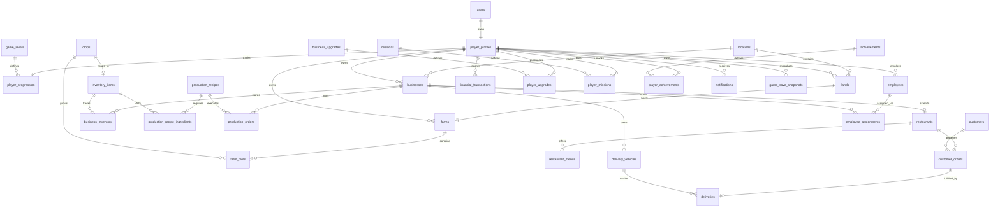

# Database Design Document: Pizza Empire Tycoon

**Document Version:** 1.0  
**Engine:** MySQL 8.0+ (InnoDB, `utf8mb4_unicode_ci`, UTC timestamps)  
**Driver:** `mysql2/promise`  
**References:** [SYSTEM_ARCHITECTURE.md](file:///home/rana/Downloads/pizz%20games%20(copy)/pizza-empire/documentation/SYSTEM_ARCHITECTURE.md) | [GAME_DESIGN.md](file:///home/rana/Downloads/pizz%20games%20(copy)/pizza-empire/documentation/GAME_DESIGN.md)

---

## 1. Architectural Conventions & Guarantees

- **Identifiers:** All primary and foreign keys use `BIGINT UNSIGNED AUTO_INCREMENT`.
- **Monetary Precision:** All currency, prices, wages, and ledger amounts use `DECIMAL(18,2)`.
- **Timestamps:** All tables store UTC `TIMESTAMP` columns (`SET time_zone = '+00:00'`).
- **Soft Deletion:** Core player-owned and user entities (`users`, `player_profiles`, `lands`, `farms`, `businesses`, `restaurants`, `delivery_vehicles`, `employees`) include `deleted_at TIMESTAMP NULL DEFAULT NULL`.
- **Non-Negative Inventory & Cash:** Enforced at the database layer via `CHECK (quantity >= 0)` on `business_inventory` and `CHECK (cash_balance >= 0.00)` on `player_profiles`, paired with `SELECT ... FOR UPDATE` row locks inside `mysql2/promise` transactions.
- **No Duplicate Active Employee Assignments:** `employee_assignments` uses a nullable `active_flag` (`1` when active, `NULL` when unassigned/historical) with `UNIQUE KEY uq_emp_active_assignment (employee_id, active_flag)`. Because MySQL `UNIQUE` indexes allow multiple `NULL`s, an employee can have full assignment history while strictly enforcing at most **one** active assignment.
- **Player Ownership:** Every player-owned resource table carries a `player_id` foreign key referencing `player_profiles(id)` so ownership checks are fast and enforceable at every query boundary.

---

## 2. Entity-Relationship Diagram (Mermaid)

---

## 3. Complete Table Specifications (33 Core Modules + Support Tables)

### Module 1: `users`
- **Columns:** `id` (`BIGINT UNSIGNED` PK), `email` (`VARCHAR(255)` NOT NULL), `username` (`VARCHAR(64)` NOT NULL), `password_hash` (`VARCHAR(255)` NOT NULL), `role` (`ENUM('PLAYER','MODERATOR','ADMIN')` DEFAULT `'PLAYER'`), `status` (`ENUM('ACTIVE','SUSPENDED','BANNED')` DEFAULT `'ACTIVE'`), `last_login_at` (`TIMESTAMP NULL`), `created_at`, `updated_at`, `deleted_at`.
- **Constraints & Indexes:** `UQ(email)`, `UQ(username)`, `IDX(role, status)`, `IDX(deleted_at)`.
- **Relationships:** 1:1 with `player_profiles`; 1:N with `refresh_tokens`, `audit_logs`.

### Module 2: `player_profiles`
- **Columns:** `id` (`BIGINT UNSIGNED` PK), `user_id` (`BIGINT UNSIGNED` FK), `display_name` (`VARCHAR(64)`), `avatar_key` (`VARCHAR(64)` DEFAULT `'default_farmer'`), `cash_balance` (`DECIMAL(18,2)` DEFAULT `1000.00`), `gems_balance` (`INT UNSIGNED` DEFAULT `0`), `net_worth` (`DECIMAL(18,2)` DEFAULT `1000.00`), `reputation` (`DECIMAL(5,2)` DEFAULT `10.00`), `max_employees_allowed` (`INT UNSIGNED` DEFAULT `30`), `offline_cap_seconds` (`INT UNSIGNED` DEFAULT `14400`), `last_active_at`, `last_tick_at`, `created_at`, `updated_at`, `deleted_at`.
- **Constraints & Indexes:** `UQ(user_id)`, `CHK(cash_balance >= 0.00)`, `IDX(net_worth)`, `IDX(last_active_at)`.

### Module 3: `player_progression`
- **Columns:** `id` (`BIGINT UNSIGNED` PK), `player_id` (`BIGINT UNSIGNED` FK), `current_level_id` (`BIGINT UNSIGNED` FK), `xp_level` (`INT UNSIGNED` DEFAULT `1`), `current_xp` (`BIGINT UNSIGNED` DEFAULT `0`), `total_crops_harvested` (`BIGINT UNSIGNED` DEFAULT `0`), `total_pizzas_sold` (`BIGINT UNSIGNED` DEFAULT `0`), `total_batches_processed` (`BIGINT UNSIGNED` DEFAULT `0`), `total_deliveries_completed` (`BIGINT UNSIGNED` DEFAULT `0`), `prestige_count` (`INT UNSIGNED` DEFAULT `0`), `created_at`, `updated_at`.
- **Constraints & Indexes:** `UQ(player_id)`, `IDX(current_level_id)`.

### Module 4: `game_levels`
- **Columns:** `id` (`BIGINT UNSIGNED` PK), `level_number` (`INT UNSIGNED`), `code` (`VARCHAR(64)`), `name` (`VARCHAR(128)`), `description` (`TEXT`), `min_xp` (`BIGINT UNSIGNED` DEFAULT `0`), `min_cash` (`DECIMAL(18,2)` DEFAULT `0.00`), `min_net_worth` (`DECIMAL(18,2)` DEFAULT `0.00`), `max_employees_cap` (`INT UNSIGNED` DEFAULT `30`), `is_mvp` (`TINYINT(1)` DEFAULT `1`), `created_at`, `updated_at`.
- **Constraints & Indexes:** `UQ(level_number)`, `UQ(code)`.

### Module 5: `lands`
- **Columns:** `id` (`BIGINT UNSIGNED` PK), `player_id` (`BIGINT UNSIGNED` FK), `location_id` (`BIGINT UNSIGNED` FK), `name` (`VARCHAR(128)` DEFAULT `'Starter Acreage'`), `total_plots_capacity` (`INT UNSIGNED` DEFAULT `12`), `unlocked_plots_count` (`INT UNSIGNED` DEFAULT `2`), `purchase_price` (`DECIMAL(18,2)` DEFAULT `0.00`), `created_at`, `updated_at`, `deleted_at`.
- **Constraints & Indexes:** `IDX(player_id)`, `IDX(location_id)`.

### Module 6: `farms`
- **Columns:** `id` (`BIGINT UNSIGNED` PK), `player_id` (`BIGINT UNSIGNED` FK), `land_id` (`BIGINT UNSIGNED` FK), `name` (`VARCHAR(128)` DEFAULT `'Green Valley Farm'`), `irrigation_level` (`INT UNSIGNED` DEFAULT `0`), `barn_capacity` (`INT UNSIGNED` DEFAULT `200`), `auto_sell_overflow` (`TINYINT(1)` DEFAULT `0`), `hourly_upkeep` (`DECIMAL(18,2)` DEFAULT `5.00`), `created_at`, `updated_at`, `deleted_at`.
- **Constraints & Indexes:** `UQ(land_id)`, `IDX(player_id)`.

### Module 7: `crops`
- **Columns:** `id` (`BIGINT UNSIGNED` PK), `code` (`VARCHAR(64)`), `name` (`VARCHAR(64)`), `seed_cost` (`DECIMAL(18,2)`), `growth_seconds` (`INT UNSIGNED`), `base_yield` (`INT UNSIGNED`), `market_sell_price` (`DECIMAL(18,2)`), `unlock_xp_level` (`INT UNSIGNED` DEFAULT `1`), `created_at`.
- **Constraints & Indexes:** `UQ(code)`.

### Module 8: `farm_plots`
- **Columns:** `id` (`BIGINT UNSIGNED` PK), `player_id` (`BIGINT UNSIGNED` FK), `farm_id` (`BIGINT UNSIGNED` FK), `plot_index` (`INT UNSIGNED`), `is_unlocked` (`TINYINT(1)` DEFAULT `0`), `crop_id` (`BIGINT UNSIGNED NULL` FK), `status` (`ENUM('EMPTY','GROWING','READY')` DEFAULT `'EMPTY'`), `hydration_pct` (`TINYINT UNSIGNED` DEFAULT `100`), `fertilizer_type` (`ENUM('NONE','COMPOST','BIO_NUTRIENT')` DEFAULT `'NONE'`), `planted_at` (`TIMESTAMP NULL`), `ready_at` (`TIMESTAMP NULL`), `created_at`, `updated_at`.
- **Constraints & Indexes:** `UQ(farm_id, plot_index)`, `IDX(player_id, status)`, `IDX(ready_at)`.

### Module 9: `inventory_items`
- **Columns:** `id` (`BIGINT UNSIGNED` PK), `code` (`VARCHAR(64)`), `name` (`VARCHAR(128)`), `category` (`ENUM('RAW_CROP','PROCESSED_INGREDIENT','PIZZA','RETAIL_GOOD')`), `unit_wholesale_buy` (`DECIMAL(18,2)` DEFAULT `0.00`), `unit_wholesale_sell` (`DECIMAL(18,2)` DEFAULT `0.00`), `crop_id` (`BIGINT UNSIGNED NULL` FK), `created_at`.
- **Constraints & Indexes:** `UQ(code)`, `IDX(category)`.

### Module 10: `business_inventory`
- **Columns:** `id` (`BIGINT UNSIGNED` PK), `player_id` (`BIGINT UNSIGNED` FK), `business_id` (`BIGINT UNSIGNED` FK), `item_id` (`BIGINT UNSIGNED` FK), `quantity` (`INT` DEFAULT `0`), `updated_at`.
- **Constraints & Indexes:** `UQ(business_id, item_id)`, `IDX(player_id)`, `CHK(quantity >= 0)`.

### Module 11: `production_recipes`
- **Columns:** `id` (`BIGINT UNSIGNED` PK), `code` (`VARCHAR(64)`), `name` (`VARCHAR(128)`), `facility_type` (`ENUM('RESTAURANT_PREP','RESTAURANT_OVEN','FACTORY')`), `output_item_id` (`BIGINT UNSIGNED` FK), `output_quantity` (`INT UNSIGNED` DEFAULT `1`), `duration_seconds` (`INT UNSIGNED`), `unlock_xp_level` (`INT UNSIGNED` DEFAULT `1`), `created_at`.
- **Constraints & Indexes:** `UQ(code)`, `IDX(facility_type)`.

### Module 12: `production_recipe_ingredients`
- **Columns:** `id` (`BIGINT UNSIGNED` PK), `recipe_id` (`BIGINT UNSIGNED` FK), `item_id` (`BIGINT UNSIGNED` FK), `quantity_required` (`INT UNSIGNED`).
- **Constraints & Indexes:** `UQ(recipe_id, item_id)`.

### Module 13: `production_orders`
- **Columns:** `id` (`BIGINT UNSIGNED` PK), `player_id` (`BIGINT UNSIGNED` FK), `business_id` (`BIGINT UNSIGNED` FK), `recipe_id` (`BIGINT UNSIGNED` FK), `batch_multiplier` (`INT UNSIGNED` DEFAULT `1`), `status` (`ENUM('QUEUED','IN_PROGRESS','COMPLETED','COLLECTED','CANCELLED')` DEFAULT `'IN_PROGRESS'`), `started_at`, `completes_at`, `collected_at` (`TIMESTAMP NULL`), `created_at`.
- **Constraints & Indexes:** `IDX(player_id, status)`, `IDX(business_id, completes_at)`.

### Module 14: `businesses`
- **Columns:** `id` (`BIGINT UNSIGNED` PK), `player_id` (`BIGINT UNSIGNED` FK), `location_id` (`BIGINT UNSIGNED` FK), `business_type` (`ENUM('FARM','RESTAURANT','FACTORY','DELIVERY_HUB','SUPERMARKET','MALL','CORPORATE_HQ')`), `name` (`VARCHAR(128)`), `level` (`INT UNSIGNED` DEFAULT `1`), `storage_capacity` (`INT UNSIGNED` DEFAULT `200`), `hourly_upkeep` (`DECIMAL(18,2)` DEFAULT `10.00`), `is_operational` (`TINYINT(1)` DEFAULT `1`), `unlocked_at`, `created_at`, `updated_at`, `deleted_at`.
- **Constraints & Indexes:** `IDX(player_id, business_type)`, `IDX(location_id)`.

### Module 15: `restaurants`
- **Columns:** `id` (`BIGINT UNSIGNED` PK), `player_id` (`BIGINT UNSIGNED` FK), `business_id` (`BIGINT UNSIGNED` FK), `oven_count` (`INT UNSIGNED` DEFAULT `1`), `prep_station_count` (`INT UNSIGNED` DEFAULT `1`), `dining_tables_count` (`INT UNSIGNED` DEFAULT `2`), `avg_rating` (`DECIMAL(3,2)` DEFAULT `4.00`), `total_ratings_count` (`BIGINT UNSIGNED` DEFAULT `0`), `decor_level` (`INT UNSIGNED` DEFAULT `1`), `created_at`, `updated_at`, `deleted_at`.
- **Constraints & Indexes:** `UQ(business_id)`, `IDX(player_id)`.

### Module 16: `restaurant_menus`
- **Columns:** `id` (`BIGINT UNSIGNED` PK), `player_id` (`BIGINT UNSIGNED` FK), `restaurant_id` (`BIGINT UNSIGNED` FK), `item_id` (`BIGINT UNSIGNED` FK), `base_price` (`DECIMAL(18,2)`), `custom_price` (`DECIMAL(18,2)`), `star_quality` (`TINYINT UNSIGNED` DEFAULT `1`), `is_enabled` (`TINYINT(1)` DEFAULT `1`), `total_sold` (`BIGINT UNSIGNED` DEFAULT `0`), `updated_at`.
- **Constraints & Indexes:** `UQ(restaurant_id, item_id)`, `IDX(player_id)`, `CHK(custom_price > 0.00)`.

### Module 17: `customers`
- **Columns:** `id` (`BIGINT UNSIGNED` PK), `code` (`VARCHAR(64)`), `archetype_name` (`VARCHAR(64)`), `price_sensitivity` (`DECIMAL(4,2)` DEFAULT `1.00`), `tip_generosity` (`DECIMAL(4,2)` DEFAULT `1.00`), `patience_seconds` (`INT UNSIGNED` DEFAULT `60`).
- **Constraints & Indexes:** `UQ(code)`.

### Module 18: `customer_orders`
- **Columns:** `id` (`BIGINT UNSIGNED` PK), `player_id` (`BIGINT UNSIGNED` FK), `restaurant_id` (`BIGINT UNSIGNED` FK), `customer_id` (`BIGINT UNSIGNED` FK), `item_id` (`BIGINT UNSIGNED` FK), `order_channel` (`ENUM('DINE_IN','TAKEAWAY','DELIVERY')` DEFAULT `'DINE_IN'`), `quantity` (`INT UNSIGNED` DEFAULT `1`), `unit_price` (`DECIMAL(18,2)`), `tip_amount` (`DECIMAL(18,2)` DEFAULT `0.00`), `total_amount` (`DECIMAL(18,2)`), `satisfaction_score` (`DECIMAL(3,2) NULL`), `status` (`ENUM('PENDING','BAKING','READY_FOR_DELIVERY','SERVED','CANCELLED')` DEFAULT `'PENDING'`), `ordered_at`, `fulfilled_at` (`TIMESTAMP NULL`).
- **Constraints & Indexes:** `IDX(player_id, status)`, `IDX(restaurant_id, ordered_at)`.

### Module 19: `delivery_vehicles`
- **Columns:** `id` (`BIGINT UNSIGNED` PK), `player_id` (`BIGINT UNSIGNED` FK), `business_id` (`BIGINT UNSIGNED` FK), `vehicle_type` (`ENUM('SCOOTER','E_BIKE','DELIVERY_VAN','AUTONOMOUS_DRONE')` DEFAULT `'SCOOTER'`), `name` (`VARCHAR(64)`), `capacity` (`INT UNSIGNED` DEFAULT `2`), `speed_multiplier` (`DECIMAL(4,2)` DEFAULT `1.00`), `hourly_maintenance` (`DECIMAL(18,2)` DEFAULT `4.00`), `status` (`ENUM('IDLE','ON_ROUTE','MAINTENANCE')` DEFAULT `'IDLE'`), `created_at`, `updated_at`, `deleted_at`.
- **Constraints & Indexes:** `IDX(player_id, status)`, `IDX(business_id)`.

### Module 20: `deliveries`
- **Columns:** `id` (`BIGINT UNSIGNED` PK), `player_id` (`BIGINT UNSIGNED` FK), `customer_order_id` (`BIGINT UNSIGNED` FK), `vehicle_id` (`BIGINT UNSIGNED` FK), `driver_employee_id` (`BIGINT UNSIGNED NULL` FK), `delivery_fee` (`DECIMAL(18,2)` DEFAULT `3.00`), `tip_amount` (`DECIMAL(18,2)` DEFAULT `0.00`), `is_on_time` (`TINYINT(1) NULL`), `status` (`ENUM('DISPATCHED','DELIVERED','FAILED')` DEFAULT `'DISPATCHED'`), `dispatched_at`, `eta_at`, `delivered_at` (`TIMESTAMP NULL`).
- **Constraints & Indexes:** `UQ(customer_order_id)`, `IDX(player_id, status)`, `IDX(vehicle_id, eta_at)`.

### Module 21: `employees`
- **Columns:** `id` (`BIGINT UNSIGNED` PK), `player_id` (`BIGINT UNSIGNED` FK), `full_name` (`VARCHAR(128)`), `department` (`ENUM(...)`), `role` (`ENUM(...)`), `skill_level` (`TINYINT UNSIGNED` DEFAULT `1`), `productivity_multiplier` (`DECIMAL(5,2)` DEFAULT `1.00`), `happiness` (`TINYINT UNSIGNED` DEFAULT `85`), `hourly_wage` (`DECIMAL(18,2)`), `is_shift_lead` (`TINYINT(1)` DEFAULT `0`), `hired_at`, `updated_at`, `deleted_at`.
- **Constraints & Indexes:** `IDX(player_id, department)`, `IDX(player_id, deleted_at)`, `CHK(happiness <= 100)`, `CHK(skill_level BETWEEN 1 AND 10)`.

### Module 22: `employee_assignments`
- **Columns:** `id` (`BIGINT UNSIGNED` PK), `player_id` (`BIGINT UNSIGNED` FK), `employee_id` (`BIGINT UNSIGNED` FK), `business_id` (`BIGINT UNSIGNED` FK), `active_flag` (`TINYINT(1) NULL` DEFAULT `1`), `assigned_at`, `unassigned_at` (`TIMESTAMP NULL`).
- **Constraints & Indexes:** `UQ(employee_id, active_flag)`, `IDX(business_id, active_flag)`, `IDX(player_id)`.

### Module 23: `financial_transactions`
- **Columns:** `id` (`BIGINT UNSIGNED` PK), `player_id` (`BIGINT UNSIGNED` FK), `business_id` (`BIGINT UNSIGNED NULL` FK), `transaction_type` (`ENUM('REVENUE','EXPENSE','CAPEX','LOAN_IN','LOAN_REPAY','REWARD','ADMIN_ADJUST')`), `category` (`ENUM(...)`), `amount` (`DECIMAL(18,2)`), `balance_after` (`DECIMAL(18,2)`), `reference_id` (`VARCHAR(64) NULL`), `description` (`VARCHAR(255) NULL`), `created_at`.
- **Constraints & Indexes:** `IDX(player_id, created_at)`, `IDX(player_id, transaction_type, category)`, `IDX(business_id)`.

### Modules 24–25: `business_upgrades` & `player_upgrades`
- `business_upgrades`: `id`, `code` (`UQ`), `name`, `category`, `business_type`, `max_level` (`10`), `base_cost` (`DECIMAL(18,2)`), `cost_growth_factor` (`DECIMAL(5,2)`), `effect_per_level` (`DECIMAL(8,4)`), `unlock_level_number`, `description`.
- `player_upgrades`: `id`, `player_id` (FK), `upgrade_id` (FK), `business_id` (FK NULL), `business_scope_id` (`GENERATED ALWAYS AS (COALESCE(business_id, 0)) STORED`), `current_level` (`0`), `updated_at`. `UQ(player_id, upgrade_id, business_scope_id)` (prevents duplicate `GLOBAL` upgrades when `business_id` is `NULL`).

### Modules 26–27: `missions` & `player_missions`
- `missions`: `id`, `code` (`UQ`), `title`, `mission_type`, `target_metric`, `target_value`, `reward_cash`, `reward_xp`, `reward_gems`, `unlock_level_number`, `is_mvp`.
- `player_missions`: `id`, `player_id` (FK), `mission_id` (FK), `progress_value` (`0`), `status` (`ACTIVE`/`COMPLETED`/`CLAIMED`), `assigned_at`, `completed_at`, `claimed_at`. `UQ(player_id, mission_id)`, `IDX(player_id, status)`.

### Modules 28–29: `achievements` & `player_achievements`
- `achievements`: `id`, `code` (`UQ`), `name`, `category`, `target_metric`, `target_value`, `reward_cash`, `reward_xp`, `reward_gems`, `description`.
- `player_achievements`: `id`, `player_id` (FK), `achievement_id` (FK), `progress_value` (`0`), `is_unlocked` (`0`), `is_claimed` (`0`), `unlocked_at`, `claimed_at`. `UQ(player_id, achievement_id)`.

### Module 30: `locations`
- **Columns:** `id`, `code` (`UQ`), `name`, `district_type`, `demand_multiplier`, `rent_multiplier`, `price_elasticity`, `unlock_level_number`, `created_at`.

### Module 31: `notifications`
- **Columns:** `id`, `player_id` (FK), `type`, `title`, `message`, `is_read` (`0`), `created_at`. `IDX(player_id, is_read, created_at)`.

### Module 32: `game_configuration`
- **Columns:** `id`, `config_key` (`UQ`), `config_value`, `value_type`, `description`, `updated_by_user_id` (FK NULL), `updated_at`.

### Module 33: `game_save_snapshots`
- **Columns:** `id`, `player_id` (FK), `snapshot_reason`, `state_json` (`JSON`), `created_at`. `IDX(player_id, created_at)`.

### Supporting Security Tables
- `refresh_tokens`: `id`, `user_id` (FK), `token_hash` (`UQ`), `expires_at`, `revoked_at`, `created_at`.
- `audit_logs`: `id`, `actor_user_id` (FK), `target_player_id`, `action_type`, `before_state` (`JSON`), `after_state` (`JSON`), `ip_address`, `created_at`.

---

## 4. Migration & Seed Execution Order

Run migrations in order `001` → `006` from [database/migrations/](file:///home/rana/Downloads/pizz%20games%20(copy)/pizza-empire/database/migrations), followed by seeds `001` → `003` from [database/seeds/](file:///home/rana/Downloads/pizz%20games%20(copy)/pizza-empire/database/seeds):

1. `001_core_users_and_progression.sql`
2. `002_locations_lands_and_farming.sql`
3. `003_inventory_and_production.sql`
4. `004_businesses_restaurants_and_delivery.sql`
5. `005_employees_and_finance.sql`
6. `006_upgrades_missions_achievements_and_system.sql`
7. `001_seed_game_levels_and_locations.sql`
8. `002_seed_crops_items_and_recipes.sql`
9. `003_seed_upgrades_missions_achievements_and_config.sql`
