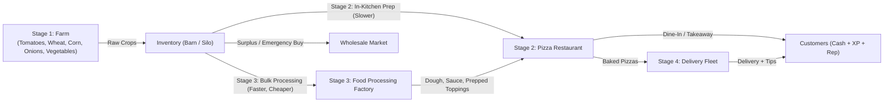

# Product Requirements Document (PRD): Pizza Empire Tycoon

**Document Version:** 1.0  
**Status:** Draft for Engineering & Design Review  
**Target Platform:** Commercial Web Browser (Desktop & Mobile Responsive)  
**Tech Stack:** React, TypeScript, Vite, Tailwind CSS, Redux Toolkit, Recharts, Framer Motion | Node.js, Express.js, TypeScript, Joi, JWT, bcrypt | MySQL 8

---

## 1. Product Vision

**Pizza Empire Tycoon** is a commercial, browser-based business simulation and tycoon game where players start with a modest agricultural plot and limited starting capital, and systematically build a vertically integrated global pizza conglomerate.

Unlike shallow clicker games, Pizza Empire Tycoon emphasizes **supply-chain mastery, unit economics, workforce scaling (up to 500 employees), and strategic expansion**. Players grow raw crops, refine them into ingredients, bake and sell pizzas, optimize delivery logistics, scale into multi-unit restaurant chains, and ultimately control supermarkets, shopping malls, and a corporate empire.

### Strategic Pillars
1. **Vertical Integration:** Every stage connects upstream and downstream—farming feeds processing, processing feeds restaurants and retail, and retail/real estate amplify empire-wide margins.
2. **Meaningful Financial Simulation:** Real-time cash flow, COGS, payroll, upkeep, loans, and P&L analytics (visualized via Recharts) reward smart management rather than mindless clicking.
3. **Accessible Depth:** Instant browser play with crisp animations (Framer Motion), intuitive dashboards, and offline progression that respects players' time.
4. **Commercial Readiness:** Built on a secure, server-authoritative Node.js/MySQL 8 architecture supporting live-ops, admin balancing, and ethical monetization.

---

## 2. Target Audience

### Primary Segments
| Segment | Profile | Motivation |
| :--- | :--- | :--- |
| **Tycoon & Management Gamers** | Ages 18–40; fans of *Game Dev Tycoon*, *Capitalism Lab*, *Factorio*-lite, *RollerCoaster Tycoon* | Optimizing production ratios, scaling revenue, unlocking new business tiers |
| **Casual Idle / Strategy Players** | Ages 20–45; browser & mobile-web players during work breaks or commutes | Satisfying progression, offline earnings, low-friction daily check-ins |
| **Entrepreneurship & Sim Enthusiasts** | Business students, startup founders, simulation hobbyists | Reading P&L charts, managing payroll vs. output, expanding into real estate |

### User Personas
- **"Optimizer Alex" (Core):** Wants spreadsheets-meets-game—tracks ingredient bottlenecks, fires underperforming staff, maximizes delivery fleet utilization.
- **"Casual Sam" (Mid-core):** Checks in 2–3 times a day for 10 minutes to harvest crops, claim offline earnings, complete daily missions, and buy the next restaurant upgrade.

---

## 3. Core Gameplay Loop

The game operates on a **dual-cadence loop**: an active micro-loop for hands-on management and a macro-loop for empire expansion.

### Micro-Loop (Session: 2–15 minutes)
1. **Collect & Harvest:** Gather matured crops (Tomatoes, Wheat, Corn, Onions, Vegetables) and claim offline/idle revenue.
2. **Process & Produce:** Convert raw crops into intermediate ingredients (e.g., Wheat → Flour/Dough, Tomatoes → Sauce) and bake Pizzas across active kitchens/factories.
3. **Fulfill & Sell:** Serve dine-in/takeaway customers, dispatch delivery orders, and stock retail shelves.
4. **Reinvest:** Pay operating expenses, hire/train staff, upgrade equipment, and unlock new recipes or slots.

### Supply-Chain Flow

### Macro-Loop (Multi-day / Long-term)
1. **Accumulate Capital & Reputation:** Meet net-worth, revenue, and mission milestones.
2. **Unlock Next Business Tier:** Transition from single farm → restaurant → factory → delivery → chain → supermarket → mall → corporate HQ.
3. **Optimize Empire Synergy:** Balance internal supply vs. external wholesale purchasing, manage up to 500 employees across departments, and maximize profit per minute.

---

## 4. Game Progression

Progression is governed by **Player Level (1–50+)**, **Empire Valuation (Net Worth)**, and **Stage Unlocks (Stages 1–8)**.

### Progression Mechanics
- **XP & Leveling:** Earned by harvesting, processing, selling pizzas, completing missions, and expanding facilities.
- **Stage Gates:** Each of the 8 business stages requires:
  - Minimum Player Level
  - Minimum Cash / Net Worth threshold
  - Completion of prerequisite stage milestone(s)
- **Soft-Lock Prevention:** Players can never permanently soft-lock. If cash drops to zero with empty inventory, players can:
  - Plant free/subsidized starter Tomato/Wheat seeds (zero-cost emergency crop)
  - Take a regulated Starter/Bailout Loan
  - Sell excess equipment or downsize staff

---

## 5. Level-by-Level Requirements (Business Stages 1–8)

Each stage introduces a new business layer while keeping previous layers automated or synergistic.

### Stage 1: Farming (Levels 1–5) — *MVP*
- **Unlock:** Default starting stage (Level 1, \$1,000 starting cash).
- **Gameplay:** Manage farm plots to plant, water/boost, and harvest **Tomatoes, Wheat, Corn, Onions, and Vegetables**.
- **Requirements:**
  - Start with 2 unlocked farm plots; expandable up to 12 plots.
  - Raw crops can be sold directly at the Farmers' Market for early cash or stored in the Barn/Silo.
  - Hire Farmhands (1–15) to automate planting and harvesting.

### Stage 2: Pizza Restaurant (Levels 5–12) — *MVP*
- **Unlock:** Level 5, \$2,500 cash, 100+ total crops harvested.
- **Gameplay:** Open the first brick-and-mortar pizzeria. Convert processed ingredients into Pizzas (Margherita, Veggie Supreme, Corn & Onion Classic, etc.) and serve walk-in customers.
- **Requirements:**
  - Kitchen prep stations + Pizza Ovens (capacity & bake-speed upgrades).
  - Dining tables determining customer throughput.
  - Hire Chefs, Prep Cooks, and Cashiers.
  - Customer satisfaction rating driven by wait time and ingredient quality.

### Stage 3: Food Processing Factory (Levels 12–20) — *MVP*
- **Unlock:** Level 12, \$15,000 cash, 500+ pizzas sold.
- **Gameplay:** Industrialize crop-to-ingredient conversion (Flour Mill, Sauce Cannery, Cheese/Veggie Prep Line, Frozen Dough Line).
- **Requirements:**
  - Batch production queues with automated input pulling from Farm Inventory.
  - Reduced unit cost per ingredient compared to manual restaurant prep.
  - Hire Factory Workers, Quality Inspectors, and Maintenance Techs.

### Stage 4: Delivery Business (Levels 20–26) — *MVP (Core) / Future (Advanced Routing)*
- **Unlock:** Level 20, \$50,000 cash, Factory operational.
- **Gameplay:** Launch a dedicated pizza delivery fleet (Scooters → E-Bikes → Delivery Vans) to capture off-premise demand.
- **Requirements:**
  - Dispatch queue with order timers and distance/zone multipliers.
  - Vehicle fleet management (purchase, capacity, speed upgrades, fuel/maintenance upkeep).
  - Hire Delivery Drivers and Dispatchers.

### Stage 5: Multiple Restaurants (Levels 26–34) — *Future (Post-MVP)*
- **Unlock:** Level 26, \$200,000 cash, 90%+ delivery rating.
- **Gameplay:** Expand from 1 flagship pizzeria to a regional chain (up to 10 restaurant locations across distinct city districts: Suburbs, Downtown, University, Financial District).
- **Requirements:**
  - District-specific customer preferences, rent costs, and price elasticity.
  - Store Managers per location to automate local staffing and inventory restocking.

### Stage 6: Supermarket (Levels 34–42) — *Future (Post-MVP)*
- **Unlock:** Level 34, \$1,000,000 cash, 3+ restaurants owned.
- **Gameplay:** Launch branded supermarkets selling both fresh farm produce and packaged/frozen Empire Pizzas & sauces directly to retail consumers.
- **Requirements:**
  - Shelf-space allocation (Produce Aisle, Frozen Pizza Aisle, Bakery/Deli).
  - High-volume supply contracts fed by Farms and Processing Factories.
  - Hire Retail Clerks, Stockers, and Store Directors.

### Stage 7: Shopping Mall (Levels 42–48) — *Future (Post-MVP)*
- **Unlock:** Level 42, \$5,000,000 cash, Supermarket profitable.
- **Gameplay:** Acquire and operate a Shopping Mall anchored by your Flagship Pizzeria and Supermarket, while leasing retail units to NPC tenant brands.
- **Requirements:**
  - Anchor store synergy (Supermarket + Pizzeria foot traffic boosts mall-wide visitors).
  - Tenant lease management (passive rental income + foot-traffic bonuses).
  - Mall Marketing & Events module.

### Stage 8: Corporate Business Empire (Levels 48–50+) — *Future (Post-MVP)*
- **Unlock:** Level 48, \$25,000,000 cash, Mall operational.
- **Gameplay:** Establish Corporate HQ with executive departments (R&D, Supply Chain Logistics, Marketing, Finance, HR) governing the entire conglomerate.
- **Requirements:**
  - C-Suite Executives providing global percentage buffs.
  - Corporate R&D tree (GMO super-crops, robotic ovens, autonomous delivery).
  - Global Market Expansion / Prestige & Leaderboard competition.

---

## 6. Business Modules

| Module | Primary Function | Key Inputs | Key Outputs | Scope |
| :--- | :--- | :--- | :--- | :--- |
| **Agri-Farm Module** | Plot management, crop cycles, soil/irrigation upgrades | Cash (seeds, water), Farmhands | Raw Crops (Tomatoes, Wheat, Corn, Onions, Vegetables) | **MVP** |
| **Pizzeria Module** | Order queue, oven baking, dining capacity, pricing | Processed Ingredients, Chefs, Cashiers | Sold Pizzas, Cash, XP, Reputation | **MVP** |
| **Processing Factory** | Bulk conversion of raw crops into culinary ingredients | Raw Crops, Factory Staff, Power/Upkeep | Flour, Dough, Tomato Sauce, Sliced Toppings | **MVP** |
| **Delivery Fleet** | Vehicle dispatch, delivery time reduction, zone reach | Pizzas, Drivers, Vehicles, Fuel | Delivery Revenue, Tips, Expanded Demand | **MVP (Basic)** / **Future (Zones)** |
| **Chain Manager** | Multi-branch overview, per-store P&L, manager assignment | Capital, Store Managers | Multi-location Pizza Revenue | **Future** |
| **Supermarket Retail** | Shelf stocking, wholesale-to-retail margin capture | Crops, Frozen Pizzas, Sauces, Clerks | High-volume Retail Cash Flow | **Future** |
| **Mall & Real Estate** | Tenant leasing, foot-traffic optimization, anchor synergy | Capital, Mall Staff | Rental Income + Traffic Multipliers | **Future** |
| **Corporate HQ** | Executive buffs, R&D lab, empire-wide analytics | Corporate Budget, Executives | Global Efficiency & Prestige | **Future** |

---

## 7. Employee Management

The game supports **up to 500 employees per player**, scaled across business units as the empire grows.

### Employee Data Model & Roles
- **Roles:** Farmhand, Prep Cook, Pizza Chef, Cashier, Factory Worker, Quality Inspector, Delivery Driver, Store Manager *(Future)*, Retail Clerk *(Future)*, Mall Operator *(Future)*, Corporate Executive *(Future)*.
- **Attributes:**
  - `Role` & `Assigned Facility`
  - `Skill Level` (1–10; improves output speed/quality)
  - `Efficiency` (multiplier, e.g., 1.0x–2.5x)
  - `Morale` (0–100%; drops if wages are unpaid or shifts are overloaded)
  - `Wage / Hour` (or per-cycle salary deducted automatically)

### Management Mechanics
- **Hiring Pool:** Refreshable candidate market with varying skill tiers and wage demands (Common, Skilled, Expert).
- **Training:** Spend cash to level up employees, increasing efficiency without consuming extra headcount slots.
- **Auto-Payroll, Morale & Default Rules:** Salaries are deducted on a fixed simulation tick/cycle. If cash is insufficient, a 3-cycle "Payroll Grace Period" triggers with a UI warning and -15% morale per missed cycle; if still unpaid, staff go on strike (0% output) until back-wages are settled.
- **Hard Cap & Facility Scaling (Up to 500 Employees):**
  - The system enforces a global cap of **500 active employees per player** across all owned facilities.
  - **MVP Facility Caps (Stages 1–4):** Expandable up to ~125–150 employees in MVP (e.g., Farm up to 30, Flagship Restaurant up to 35, Processing Factory up to 50, Delivery Fleet up to 35) while the backend/UI architecture is built and load-tested for the full **500-employee** limit unlocked across Stages 5–8.
  - **Bulk Management Tools:** Filter by facility/role/morale, sort by efficiency/wage, multi-select batch-assign, batch-train, and paginated/virtualized employee tables so managing 500 employees remains lag-free.

---

## 8. Financial System

A transparent, realistic financial engine drives decision-making and powers Recharts dashboards.

### Currencies
1. **Cash (\$):** Primary soft currency earned from sales and spent on operations, wages, seeds, upgrades, and expansions.
2. **Empire Gems (Hard Currency):** Premium/milestone currency earned sparingly via achievements/missions or purchased via IAP; used for time-skips, cosmetic skins, or extra hiring slots (never pay-to-win mandatory).

### Financial Mechanics
- **Revenue Streams:** Raw crop sales, Dine-in/Takeaway pizza sales, Delivery orders (+tips), Retail/Supermarket sales *(Future)*, Mall rent *(Future)*.
- **Operating Expenses (OpEx):**
  - Employee Payroll
  - Facility Rent & Utilities
  - Seed & Emergency Wholesale Ingredient Purchases
  - Vehicle Maintenance & Fuel
  - Loan Interest
- **Banking & Loans:**
  - Players can take structured business loans (e.g., Small Business Loan, Expansion Loan) with fixed repayment schedules and interest rates.
- **Analytics & Reporting (Recharts):**
  - **Cash Flow Chart:** Revenue vs. Expenses over last 24h / 7d / 30 cycles.
  - **Profit & Loss (P&L) Breakdown:** Margin by business unit (Farm vs. Restaurant vs. Factory).
  - **Expense Pie Chart:** Payroll vs. Upkeep vs. Materials.

---

## 9. Inventory System

### Storage Architecture
- **Shared Empire Warehouse (with Facility Buffers):**
  - **Barn / Silo:** Stores raw crops (Tomatoes, Wheat, Corn, Onions, Vegetables).
  - **Cold Storage / Pantry:** Stores processed ingredients (Dough, Tomato Sauce, Cheese/Toppings, Frozen Pizzas).
- **Capacity Limits:** Storage has a finite capacity (units) upgradable with cash. Overflow halts production or triggers an optional "Auto-Sell Excess at Wholesale Discount" toggle.

### Wholesale Market (Fallback & Arbitrage)
- If a player's farm cannot keep up with restaurant demand, they can buy missing raw crops or ingredients from the **Wholesale Market** at a markup (preserving gameplay flow while incentivizing vertical integration).
- Conversely, surplus raw crops can be liquidated on the Wholesale Market for immediate cash.

### Spoilage / Freshness *(Future)*
- *MVP:* No spoilage to keep onboarding frustration-free.
- *Future:* Optional freshness decay for raw produce unless Cold Storage upgrades are purchased.

---

## 10. Production System

### Crop Growth & Recipes
1. **Farming Layer:**
   - **Tomatoes:** Fast growth, foundational for Sauce.
   - **Wheat:** Fast-medium growth, foundational for Dough.
   - **Corn:** Medium growth, specialty topping & retail grain.
   - **Onions:** Medium growth, savory topping & sauce enhancer.
   - **Vegetables (Peppers/Mushrooms/Spinach):** Slower growth, high-margin gourmet toppings.

2. **Processing Layer (Factory / Prep):**
   - `Wheat (x2)` → `Pizza Dough (x2)`
   - `Tomatoes (x3)` → `Tomato Sauce (x2)`
   - `Tomatoes (x2) + Onions (x1)` → `Gourmet Marinara (x2)`
   - `Corn / Onions / Vegetables` → `Prepped Toppings`

3. **Pizza Manufacturing Layer:**
   - **Classic Margherita:** Dough + Tomato Sauce (Base margin)
   - **Golden Corn Pizza:** Dough + Tomato Sauce + Corn (Medium margin)
   - **Onion & Herb Pizza:** Dough + Tomato Sauce + Onions (Medium-high margin)
   - **Supreme Veggie Feast:** Dough + Gourmet Marinara + Corn + Onions + Vegetables (High margin, longer bake time)

### Production Rules
- **Stage 2 vs. Stage 3 Processing Handoff:** Before unlocking the Food Processing Factory (Stage 3), the Pizza Restaurant performs **In-Kitchen Prep** (manual dough kneading and sauce simmering) at slower speeds and higher labor cost. Unlocking Stage 3 offloads this into high-volume, lower-unit-cost factory batches.
- **Server-Validated Timers:** All crop growth, factory batches, and baking cycles use server timestamps (`started_at`, `duration_seconds`) so client clock manipulation is impossible.
- **Bottleneck Indicators:** UI clearly highlights missing inputs (e.g., "Out of Dough — Check Wheat/Factory") with one-click navigation.

---

## 11. Upgrade System

Upgrades are categorized into four clear tracks:

1. **Facility Upgrades:** Expand farm plots, add pizza ovens, add dining tables, expand warehouse capacity, add factory assembly lines.
2. **Equipment & Automation:** Drip irrigation (faster crops), Brick/Conveyor Ovens (faster bake + higher quality), Automated Dough Mixers, Electric Delivery Vans.
3. **Recipe & Quality Upgrades:** Improve pizza star-rating (1★ to 5★), increasing customer willingness-to-pay and tip rates.
4. **Empire-Wide Tech / R&D:** *(MVP: basic efficiency perks; Future: full Corporate R&D tree)* Global speed, wage reduction, and offline cap extensions.

---

## 12. Missions and Achievements

### Missions (Guided Progression)
- **Onboarding Tutorial Missions:** Step-by-step guided tasks ("Plant your first Tomatoes", "Harvest 10 Wheat", "Open your Pizza Restaurant", "Hire 1 Chef").
- **Daily & Weekly Missions:** Rotating objectives ("Sell 150 Margherita Pizzas", "Earn \$5,000 in Delivery Revenue", "Train 3 Employees") rewarding Cash, XP, and occasional Gems.

### Achievements (Milestone Badges)
- Tiered Bronze / Silver / Gold / Platinum badges across categories:
  - *Agrarian:* Harvest 1,000 / 50,000 / 1,000,000 crops.
  - *Master Pizzaiolo:* Bake 500 / 25,000 / 500,000 pizzas.
  - *Job Creator:* Employ 10 / 100 / 250 / 500 staff simultaneously.
  - *Tycoon:* Reach \$100K / \$10M / \$1B net worth.

---

## 13. Offline Earnings

Players continue earning while logged out, calculated **server-side** upon next login/session resume.

### Calculation Rules
- **Offline Cap:** Base cap of **4 hours** (upgradable to **8h / 12h / 24h** via upgrades or VIP).
- **Efficiency Rate:** Automated facilities (staffed Farms, Restaurants, Factories, Delivery) operate at **50%–75% of active online net profit rate** (after deducting simulated wages and ingredient consumption).
- **Zero-Negative Protection:** Offline simulation never puts a player into negative cash; if ingredients run out mid-offline, production pauses cleanly and only realized profit is awarded.
- **Welcome-Back Modal:** Displays breakdown of time away, crops harvested, pizzas sold, wages paid, and net cash earned, with a "Claim" button (and optional 2x boost via rewarded ad or Gem spend in commercial release).

---

## 14. Admin Management

A dedicated, role-protected **Admin Portal** (separate route/interface) for live-ops, customer support, and game balancing.

### Admin Capabilities
- **Player Management:** Search players by email/ID, view empire state, inspect transaction logs, grant/deduct currency (support tickets), ban/suspend cheaters.
- **Game Balance Config (Live-Ops):** Adjust crop growth times, pizza base prices, employee wage curves, and offline cap parameters without redeploying code.
- **Mission & Event Manager:** Create/toggle limited-time events (e.g., "Double Harvest Weekend") and manage mission pools.
- **System Telemetry:** Monitor active players, server tick health, economy inflation metrics (total cash in circulation), and error logs.

---

## 15. Monetization Strategy

Designed for **ethical, high-retention commercial browser monetization** (no aggressive paywalls).

### Revenue Channels (Future / Commercial Launch Phase)
1. **Starter & Expansion Packs (One-Time IAP):** Curated bundles containing Empire Gems, a cosmetic restaurant theme, and a temporary 24h production boost.
2. **Empire Gems (Hard Currency IAP):** Used for instant batch completion, extra candidate refreshes, cosmetic skins, and offline-cap extensions.
3. **VIP / "Executive Pass" (Monthly Subscription):**
   - Extends offline earnings cap from 4h to 12h.
   - +10% global production speed & ad-free 2x offline claim.
   - Exclusive Corporate HQ cosmetic badge.
4. **Rewarded Video Ads (Optional, Browser-Friendly):** Watch an opt-in ad to double offline earnings or get an emergency cash injection.

*Note: All payment processing (Stripe/Paddle) and IAP fulfillment are scoped for Post-MVP commercial launch.*

---

## 16. Security Requirements

1. **Authentication & Session Security:**
   - Passwords hashed with `bcrypt` (minimum cost factor 10–12).
   - Stateless `JWT` access tokens (short-lived) + secure `HttpOnly` refresh token strategy.
   - Role-based access control (`PLAYER`, `MODERATOR`, `ADMIN`).
2. **Server-Authoritative Game Logic:**
   - All financial transactions, inventory mutations, crop timers, and offline earnings MUST be calculated and validated on the Node.js/Express backend. Never trust client-submitted cash, XP, or prices.
3. **Input Validation & Injection Prevention:**
   - Strict schema validation on every API endpoint using `Joi`.
   - Parameterized SQL queries / ORM prepared statements in MySQL 8 to prevent SQL injection.
4. **Anti-Cheat & Abuse Prevention:**
   - Rate limiting on all auth and action endpoints (e.g., harvest/sell spam protection).
   - Idempotency keys or atomic MySQL transactions (`FOR UPDATE` row locking) to prevent race-condition duplication exploits (double-spending cash or duplicating inventory).
5. **Audit Logging & Transport Security:**
   - Immutable audit logs in MySQL for all Admin actions (currency grants, bans, balance config edits) and high-value financial events (loans, expansions).
   - HTTPS/TLS enforced in production, strict CORS allowlist, and Helmet security headers.

---

## 17. Performance Requirements

1. **Frontend Responsiveness:**
   - Initial bundle load (Vite code-splitting) under **2.0 seconds** on broadband.
   - UI interactions and Framer Motion transitions maintain **60 FPS**; Redux Toolkit state updates batched cleanly.
   - Employee table virtualized/paginated so managing **500 employees** causes zero UI lag.
2. **Backend & Database:**
   - API P95 response time **< 150ms** for standard actions (harvest, bake, hire).
   - MySQL 8 indexed on `player_id`, `facility_id`, `status`, and `updated_at` to support fast transactional queries.
   - Efficient tick/timestamp evaluation: avoid heavy per-second cron loops for idle players; compute elapsed deltas lazily on request/heartbeat and use lightweight periodic workers only where needed.
3. **Scalability & Stack Architecture:**
   - Stateless Express API servers capable of horizontal scaling behind a load balancer, backed by a properly sized MySQL 8 connection pool.
   - **Frontend State & Rendering:** Redux Toolkit manages normalized domain slices (`auth`, `empire`, `farm`, `restaurant`, `factory`, `delivery`, `employees`, `finance`); Framer Motion animations use GPU-composited properties (`transform`, `opacity`) to preserve 60 FPS.
   - **Validation Boundary:** Every Express route enforces `Joi` request validation middleware before hitting controller/service logic.

---

## 18. MVP Scope vs. Future Features

To ship a playable, commercial-quality v1.0 rapidly, features are strictly partitioned.

### MVP Scope (v1.0 Launch)
- **Authentication & Core Infra:** Register/Login (JWT + bcrypt), Joi validation, MySQL 8 persistence, Redux Toolkit state sync.
- **Business Stages 1–4 (Core):**
  - **Stage 1:** Farming (all 5 crops: Tomatoes, Wheat, Corn, Onions, Vegetables; up to 12 plots).
  - **Stage 2:** Pizza Restaurant (single flagship restaurant, ovens, tables, 4 core pizza recipes).
  - **Stage 3:** Food Processing Factory (Flour/Dough, Sauce, Prepped Toppings).
  - **Stage 4:** Delivery Business (basic fleet dispatch & driver assignment).
- **Systems:**
  - Employee Management (hiring, assigning, wages, training, up to 500-employee architecture).
  - Financial System (Cash, Loans, P&L & Cash Flow Recharts dashboard).
  - Inventory & Production Systems (Barn/Pantry storage, Wholesale fallback).
  - Upgrade System (Facility, Equipment, Recipe quality).
  - Missions & Achievements (Onboarding + core milestones).
  - Offline Earnings (Server-calculated up to 4h cap + Welcome-Back modal).
  - Basic Admin Dashboard (Player lookup, balance tuning, ban/grant tools).

### Future Features (Post-MVP)
- **Business Stages 5–8:** Multiple Restaurants (district map), Supermarket, Shopping Mall, Corporate Business Empire (C-Suite & R&D tree).
- **Advanced Simulation:** Ingredient spoilage/cold-chain mechanics, dynamic weather affecting crop yields, regional competitor AI.
- **Commercial Monetization:** Stripe/Paddle integration, Executive Pass subscription, Empire Gems store, Rewarded Ads.
- **Social & Competitive:** Global Net-Worth Leaderboards, Seasonal Tycoon Events, Co-op Supply Contracts between players.

---

## 19. Future Roadmap

| Phase | Timeline Target | Key Deliverables |
| :--- | :--- | :--- |
| **Phase 1: MVP Build** | Weeks 1–8 | Auth, DB schema, Stages 1–4, Employee/Inventory/Finance/Production engines, Offline earnings, Basic Admin |
| **Phase 2: Beta & Balancing** | Weeks 9–10 | Closed beta playtesting, economy tuning via Admin portal, performance profiling for 500-employee accounts |
| **Phase 3: Commercial Launch & Monetization** | Weeks 11–13 | Payment gateway integration, Executive Pass, Gem Shop, Daily/Weekly live-ops events |
| **Phase 4: Empire Expansion (Stages 5–6)** | Months 4–5 | Multi-Restaurant Chain Manager, City Districts, Supermarket Retail & Cold-Chain mechanics |
| **Phase 5: Endgame & Social (Stages 7–8)** | Months 6+ | Shopping Mall & Tenant Leasing, Corporate HQ & R&D Tree, Leaderboards, Seasonal Events |

---

## 20. Acceptance Criteria

The MVP (v1.0) will be considered complete and ready for beta release when all of the following criteria are met:

1. **Account & Security:**
   - Users can register, log in, and refresh sessions via JWT + bcrypt; all API payloads are validated with Joi and unauthorized/invalid requests return structured `400`/`401`/`403` responses.
2. **End-to-End Core Loop (Stages 1–4):**
   - A new player can plant and harvest all 5 crops, process them in the Factory, bake and sell Pizzas in the Restaurant, and dispatch orders via the Delivery Business without errors or soft-locks.
3. **Server Authority & Data Integrity:**
   - Refreshing the browser preserves exact game state from MySQL 8; concurrent requests cannot duplicate cash or inventory items.
4. **Workforce Scaling:**
   - A test account can hire, assign, pay wages for, and manage **500 employees** with UI table rendering and API payroll processing remaining within performance targets (< 150ms API, smooth UI).
5. **Financial Analytics:**
   - Recharts accurately displays real-time revenue, expenses, and net profit history matching backend transaction records.
6. **Offline Earnings:**
   - Logging out for a measurable duration (e.g., 10+ minutes) and logging back in triggers the Welcome-Back modal with accurate, server-calculated net earnings capped at 4 hours.
7. **Admin Controls:**
   - An Admin user can log into the Admin Portal, view a player's state, and adjust a game balance parameter (e.g., crop sell price) with immediate effect.
