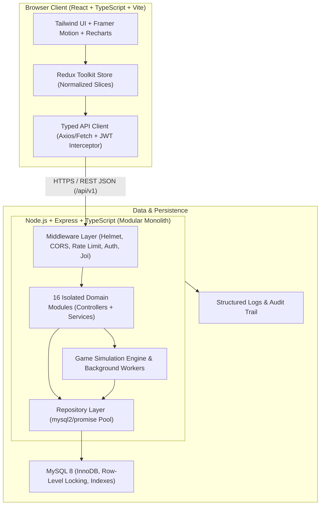
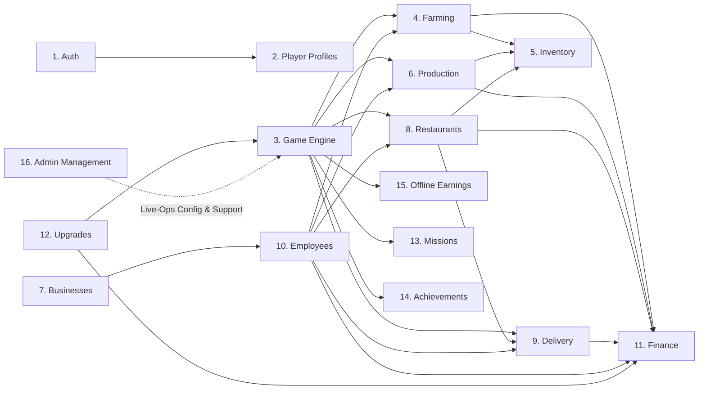
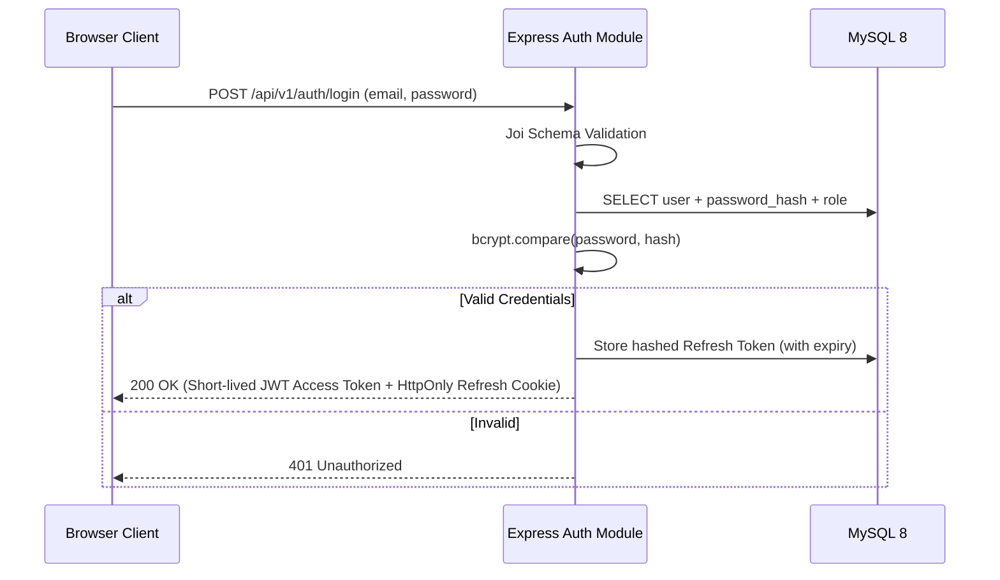

# System Architecture Document: Pizza Empire Tycoon

**Document Version:** 1.0  
**References:** [PRD.md](file:///home/rana/Downloads/pizz%20games%20(copy)/pizza-empire/documentation/PRD.md) | [GAME_DESIGN.md](file:///home/rana/Downloads/pizz%20games%20(copy)/pizza-empire/documentation/GAME_DESIGN.md)  
**Architectural Style:** Modular Monolith (Server-Authoritative)  
**Stack:** React, TypeScript, Vite, Tailwind CSS, Redux Toolkit | Node.js, Express, TypeScript, Joi, JWT, bcrypt | MySQL 8 (`mysql2/promise`)

---

## 1. High-Level System Overview

Pizza Empire Tycoon uses a **Modular Monolith** architecture for its v1.0 commercial release. All 16 backend domains live within a single deployable Node.js/Express application with strict internal module boundaries (Controller → Validation → Service → Repository), communicating with a single MySQL 8 relational database via `mysql2/promise`.

This avoids premature microservices overhead (distributed transactions, network latency) while guaranteeing **ACID transactional integrity** for player cash, inventory, and 500-employee payroll—and keeps module boundaries clean enough to extract services later if scale demands.

---

## 2. Modular Breakdown (16 Core Systems)

Each module owns its routes, Joi validation schemas, service logic, and MySQL repository queries. Cross-module mutations occur **only through exported Service interfaces** (passing an active `PoolConnection` when participating in a shared database transaction).

| # | Module | Primary Responsibilities | Key Interactions / Dependencies |
| :--- | :--- | :--- | :--- |
| **1** | **Authentication** | Registration, login, `bcrypt` hashing, `JWT` access/refresh token issuance & rotation, session revocation | Calls `Player Profiles` on signup to initialize new empire; `Admin` for bans |
| **2** | **Player Profiles** | Player metadata, Empire XP, Major Level (1–8), Reputation, `last_active_at`, UI preferences | Read by `Game Engine`, `Missions`, `Achievements`, `Offline Earnings` |
| **3** | **Game Engine** | Central simulation coordinator: lazy elapsed-time delta evaluation, tick orchestration, stage-unlock checks | Orchestrates `Farming`, `Production`, `Restaurants`, `Delivery`, `Employees`, `Finance` |
| **4** | **Farming** | Plot ownership (2–12), planting, watering, fertilizer buffs, growth timers, harvesting | Consumes cash via `Finance`; deposits raw crops into `Inventory`; triggers `Missions` |
| **5** | **Inventory** | Barn/Silo (raw crops) & Pantry/Cold Storage (ingredients/pizzas), capacity limits, Wholesale Market | Supplies `Production` & `Restaurants`; settles Wholesale trades with `Finance` |
| **6** | **Production** | Stage 2 In-Kitchen Prep & Stage 3 Processing Factory batch queues, quality checks | Pulls raw crops from `Inventory`; outputs Dough/Sauce/Toppings back to `Inventory` |
| **7** | **Businesses** | Facility registry (Farm, Flagship Restaurant, Factory, Delivery Hub, future Chain/Mall), upkeep | Read by `Employees` (assignments), `Upgrades`, `Finance` (facility rent) |
| **8** | **Restaurants** | Order queue, oven baking, dining tables, customer satisfaction (1★–5★), dynamic pricing | Pulls ingredients from `Inventory`; records sales in `Finance`; feeds `Delivery` |
| **9** | **Delivery** | Vehicle fleet (Scooters, E-Bikes, Vans), driver dispatch, transit timers, tip calculation | Pulls baked pizzas from `Restaurants`; credits delivery revenue/tips to `Finance` |
| **10** | **Employees** | Up to **500 employees/player**, hiring pool, assignments, skill training (1–10), happiness, payroll | Assigned to `Businesses`; productivity boosts `Farming`/`Production`/`Restaurants`/`Delivery` |
| **11** | **Finance** | Cash & Gem ledgers, P&L history, CapEx tracking, Starter/Expansion Loans, payroll deductions | Central ledger called atomically by nearly all modules; feeds Recharts analytics |
| **12** | **Upgrades** | Facility, Equipment, Recipe Quality, Fleet, and Empire Tech upgrade definitions & level state | Deducts cash via `Finance`; applies multipliers read by `Game Engine` & modules |
| **13** | **Missions** | Onboarding, daily, and milestone mission progress tracking & reward claiming | Listens to domain events from `Farming`, `Restaurants`, `Delivery`, `Employees` |
| **14** | **Achievements** | 24+ tiered milestone badges, progress counters, Gem/Cash reward payouts | Evaluates cumulative stats from `Player Profiles` & domain repositories |
| **15** | **Offline Earnings** | Server-side idle simulation on login/resume (4h–24h cap, 60% rate, resource depletion check) | Invoked by `Game Engine` on session resume; updates `Inventory`, `Finance`, `Profiles` |
| **16** | **Admin Management** | Player lookup, currency grants, bans, live-ops balance config, mission/event toggles, audit logs | Protected by `ADMIN` RBAC; reads/writes global config & player state with audit trail |

### Module Dependency Diagram

---

## 3. Frontend Architecture

Built with **React 18 + TypeScript + Vite + Tailwind CSS**, using **Redux Toolkit** for state, **Recharts** for financial visualizations, and **Framer Motion** for tactile tycoon feedback.

### Directory & Layer Structure (Conceptual)
- **App Shell & Routing:** Route-guarded layout separating Public Auth (`/login`, `/register`), Core Game (`/game/*`), and Admin Portal (`/admin/*`).
- **Feature Modules:** Organized by business domain (`farm/`, `restaurant/`, `factory/`, `delivery/`, `employees/`, `finance/`, `missions/`, `admin/`).
- **State Management (Redux Toolkit):**
  - Normalized slices: `authSlice`, `profileSlice`, `farmSlice`, `inventorySlice`, `productionSlice`, `restaurantSlice`, `deliverySlice`, `employeesSlice`, `financeSlice`, `missionsSlice`, `uiSlice`.
  - **RTK Query or Async Thunks:** Handles API communication, optimistic UI hints where safe (e.g., button disabled states), and authoritative state reconciliation from server responses.
  - **Client-Side Visual Interpolation:** Timers (crop growth bars, oven progress, delivery transit) interpolate smoothly at 60 FPS using server-provided `startedAt` and `endsAt` timestamps, then trigger a server sync upon completion.
- **UI & Visualization:**
  - **Tailwind CSS:** Responsive grid/card layouts with dark/light tycoon theme tokens.
  - **Framer Motion:** GPU-composited animations (`transform`, `opacity`) for crop harvest pops, cash floaters, and modal transitions.
  - **Recharts:** Memoized `ResponsiveContainer` charts for Cash Flow (AreaChart), Unit P&L (BarChart), and Expense Breakdown (PieChart).
  - **500-Employee Virtualization:** Employee management table uses windowed/virtualized rendering + server-side/memoized filtering so 500 rows render with zero frame drops.

---

## 4. Backend Architecture

Built on **Node.js + Express + TypeScript** following a strict 4-layer pattern per module:

1. **Router & Middleware Layer:** Express routers attach `authenticateJWT`, `requireRole(...)`, `rateLimiter`, and `validateRequest(joiSchema)`.
2. **Controller Layer:** Extracts validated DTOs (`req.body`, `req.params`, `req.query`), invokes the Service, and formats the standardized HTTP response. No SQL or business rules live here.
3. **Service Layer:** Contains all game rules, formulas, cross-module orchestration, and transaction boundaries (`withTransaction`).
4. **Repository Layer:** Pure `mysql2/promise` data-access methods executing parameterized SQL queries against an injected `Pool` or `PoolConnection`.

---

## 5. Database Communication (`mysql2/promise` + MySQL 8)

- **Connection Pooling:** A singleton `mysql2/promise` connection pool (`connectionLimit` tuned to environment, `waitForConnections: true`, `namedPlaceholders` or `?` positional bindings).
- **Parameterized Queries Only:** Zero string interpolation in SQL; all inputs bound via `mysql2` prepared/parameterized statements.
- **Read/Write Separation Ready:** Queries accept an optional `PoolConnection` so single reads use the pool directly while state-mutating operations share a single transactional connection.
- **Static Config Caching:** Immutable/low-churn game catalogs (crops, recipes, upgrade curves, mission/achievement definitions) are seeded in MySQL 8 and cached in server memory on startup, with cache invalidation triggered whenever an Admin updates live-ops balance configs.
- **Schema Design Principles:**
  - InnoDB engine for ACID compliance and row-level locking.
  - Decimal/BIGINT precision for currency (`DECIMAL(15,2)` or integer cents) to avoid IEEE-754 floating-point drift.
  - Composite indexes on `(player_id, status)`, `(player_id, facility_id)`, and `(player_id, created_at)` for fast queries across 500 employees and financial ledgers.

---

## 6. API Architecture

- **Protocol & Versioning:** RESTful JSON over HTTPS, prefixed with `/api/v1`.
- **Resource-Oriented Endpoints:**
  - `/api/v1/auth/*` (register, login, refresh, logout)
  - `/api/v1/game/sync` (heartbeat + lazy simulation catch-up + offline claim)
  - `/api/v1/farm/*`, `/api/v1/inventory/*`, `/api/v1/production/*`, `/api/v1/restaurants/*`, `/api/v1/delivery/*`
  - `/api/v1/employees/*` (paginated list, hire, train, bulk-assign, bulk-morale)
  - `/api/v1/finance/*` (ledger, analytics, loans)
  - `/api/v1/upgrades/*`, `/api/v1/missions/*`, `/api/v1/achievements/*`
  - `/api/v1/admin/*` (role-restricted live-ops & support)
- **Standardized Response Envelope:**
  - Success: `{ success: true, data: { ... }, meta?: { page, total } }`
  - Error: `{ success: false, error: { code, message, details? }, requestId }`
- **Validation (`Joi`):** Every `POST`, `PUT`, `PATCH`, and parameterized `GET` validates body, params, and query against strict `Joi` schemas (stripping unknown fields).

---

## 7. Authentication & Authorization Flow

### Authentication (JWT + bcrypt)

- **Access Token:** Short-lived JWT (15 minutes) carrying `{ userId, playerId, role }`, sent in `Authorization: Bearer <token>`.
- **Refresh Token:** Long-lived opaque/JWT token (7 days) stored in an `HttpOnly`, `Secure`, `SameSite=Strict` cookie and hashed in MySQL to support **token rotation** and immediate revocation on logout/ban.
- **Password Security:** Hashed with `bcrypt` (cost factor 12).

### Authorization (RBAC + Ownership)
- **Role-Based Access Control (RBAC):** Middleware checks `req.user.role` against allowed roles (`PLAYER`, `MODERATOR`, `ADMIN`).
- **Resource Ownership:** Every player endpoint derives `playerId` strictly from the verified JWT (`req.user.playerId`), never from request body parameters, preventing Insecure Direct Object Reference (IDOR) attacks.

---

## 8. Game Simulation Architecture & Background Jobs

### Hybrid Simulation Model (Lazy Evaluation + Lightweight Workers)
Simulating thousands of players every second via in-memory loops wastes CPU and breaks horizontal scaling. Instead, Pizza Empire Tycoon uses a **Hybrid Server-Authoritative Model**:

1. **Lazy Timestamp Evaluation (Primary Engine):**
   - Crop plots, factory batches, oven bakes, and delivery trips store `started_at` and `ends_at` timestamps in MySQL.
   - When a player acts or calls `/api/v1/game/sync` (e.g., every 15–30s while active, or on login), the **Game Engine** computes elapsed time since `last_tick_at`:
     - If idle duration exceeds the offline threshold (e.g., 5+ minutes), the **Offline Earnings** module generates a `pending_offline_session` summary (capped at 4h–24h) rather than auto-crediting silently, allowing the client to present the Welcome-Back modal and commit via `POST /api/v1/offline/claim`.
     - Otherwise, it processes completed timers, computes automated employee output, deducts prorated payroll/upkeep, and checks ingredient availability sequentially.
2. **Background Jobs (Scheduled Cron / Worker Queue):**
   - **Daily/Weekly Mission Resetter:** Runs at UTC midnight to rotate daily missions.
   - **Loan & Interest Settlement:** Processes scheduled loan repayments for active accounts.
   - **Leaderboard / Telemetry Aggregator:** Periodically snapshots economy health metrics (cash in circulation, active players) for the Admin Dashboard.
   - **Session & Audit Cleanup:** Purges expired refresh tokens and archives old telemetry logs.

---

## 9. Transaction Management

Financial and inventory mutations are high-risk targets for race conditions (e.g., double-clicking "Buy Upgrade" or "Sell Crops").

- **Atomic Unit of Work:** Every mutating Service operation wraps its DB writes in `conn.beginTransaction()` → `commit()` / `rollback()` using `mysql2/promise`.
- **Pessimistic Row Locking (`FOR UPDATE`):** Before deducting Cash or Inventory, the repository locks the player's wallet/inventory row (`SELECT cash FROM player_wallets WHERE player_id = ? FOR UPDATE`) so concurrent requests serialize cleanly.
- **Idempotency Keys:** Critical actions (claim offline earnings, claim mission reward, loan disbursement) accept/enforce state flags (`claimed = 0 -> 1` inside the transaction) so duplicate requests cannot pay out twice.

---

## 10. Error Handling & Logging

### Centralized Error Handling
- Custom typed error hierarchy extending `AppError`: `ValidationError (400)`, `UnauthorizedError (401)`, `ForbiddenError (403)`, `NotFoundError (404)`, `ConflictError (409)`, `InsufficientFundsError (422)`, `RateLimitError (429)`.
- Global Express error middleware catches both synchronous and `async` route errors, maps `Joi` and MySQL error codes (e.g., `ER_DUP_ENTRY` → `409`), hides internal stack traces in production, and returns a consistent JSON payload with `requestId`.

### Structured Logging & Audit Trail
- **Application Logs:** Structured JSON logs (with `requestId`, `playerId`, `module`, `durationMs`, `level`) for observability.
- **Financial & Admin Audit Logs:** Stored in MySQL (`audit_logs` table) capturing `actor_id`, `action_type`, `target_player_id`, `before_state`, `after_state`, and `ip_address` for every Admin action and major financial event.

---

## 11. Security & Performance Optimization

### Security Controls
- **Server Authority:** Client never submits prices, crop yields, XP, or cash deltas; backend derives all values from authoritative DB config tables.
- **Input & Transport Hardening:** `Joi` strict schema validation, `helmet()` security headers, strict `cors()` origin allowlist with `credentials: true` (supporting `HttpOnly` refresh cookies across Vite/Express origins), and `express-rate-limit` (stricter limits on `/auth/*` and `/game/sync`).
- **SQL Injection Immunity:** 100% parameterized queries via `mysql2/promise`.

### Performance Optimization
- **Database:** Composite indexes on high-traffic tables (`employees`, `inventory_items`, `financial_transactions`); pagination on transaction history and 500-employee lists.
- **API Payload:** `/game/sync` returns delta/dirty state or compact DTOs; gzip/brotli compression enabled on Express responses.
- **Frontend:** Vite route-based code splitting (`React.lazy` for Admin Portal and heavy Recharts views), memoized selectors in Redux Toolkit, and virtualized lists for 500-employee management.
